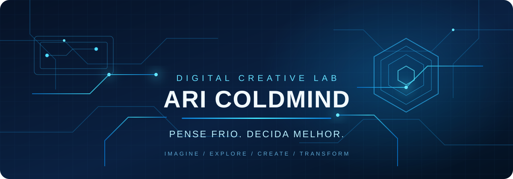
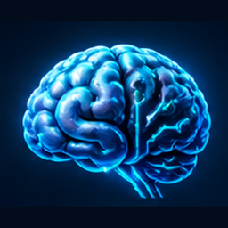
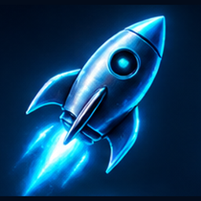
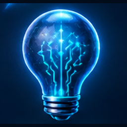
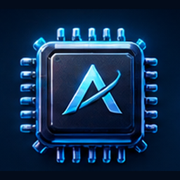
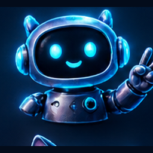
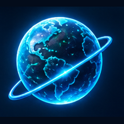
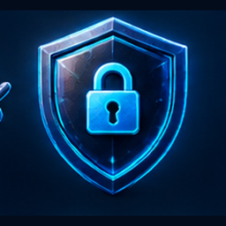

<!-- ========================================= -->
<!-- ARI.COLDMIND — PERSONAL BRAND README       -->
<!-- ========================================= -->

  

  <strong>UMA MENTE INQUIETA. POSSIBILIDADES INFINITAS.</strong>

  <a href="#universo">UNIVERSO</a> ·
  <a href="#criacao">CRIAÇÃO</a> ·
  <a href="#laboratorio">LABORATÓRIO</a> ·
  <a href="#visao">VISÃO</a>

---

<h2>
  
  01 — THE MIND
</h2>

Não é preciso ser um gênio para criar algo extraordinário.

É preciso imaginar, questionar, experimentar e ter coragem de transformar ideias em realidade.

Este é o espaço onde minha imaginação encontra a tecnologia.

  
  

---

<h2>
  
  02 — CREATIVE DIMENSIONS
</h2>

<table>
<tr>
<td width="50%" align="center">
  
  <h3>IMAGINAR</h3>
  Explorar o que ainda não existe.
</td>
<td width="50%" align="center">
  
  <h3>CONSTRUIR</h3>
  Transformar pensamentos em tecnologia.
</td>
</tr>
<tr>
<td align="center">
  
  <h3>EXPERIMENTAR</h3>
  Descobrir novas possibilidades.
</td>
<td align="center">
  
  <h3>TRANSFORMAR</h3>
  Criar soluções para pessoas.
</td>
</tr>
</table>

---

<h2>
  
  03 — THE LABORATORY
</h2>

  
  Projetos e experiências

 

Um espaço para projetos, protótipos, experimentos e ideias em desenvolvimento.

Cada criação representa uma possibilidade de transformar o futuro em realidade.

  
  Tecnologias e ferramentas

 

Áreas de exploração:

- Python
- Inteligência Artificial
- Machine Learning
- Arquitetura de Software
- DevOps
- Cloud Computing
- Engenharia de Software

  
  Ideias em construção

 

Nem toda ideia nasce pronta. Algumas começam como perguntas, outras como experimentos.

Aqui, o processo de descoberta também faz parte da criação.

---

<h2>
  
  04 — THE VISION
</h2>

A tecnologia deve ampliar possibilidades, aproximar pessoas e tornar o conhecimento uma ferramenta de transformação.

Quero contribuir para um mundo em que qualquer pessoa possa imaginar, aprender, criar e transformar suas ideias em realidade.

  
   
  <strong>O FUTURO NÃO É APENAS ALGO QUE ESPERAMOS.</strong>
   
  <strong>É ALGO QUE PODEMOS CONSTRUIR.</strong>

---

  
   
  <strong>ARI.COLDMIND</strong>
   
  PENSE FRIO. DECIDA MELHOR.
   
  IMAGINE · EXPLORE · CRIE · TRANSFORME

